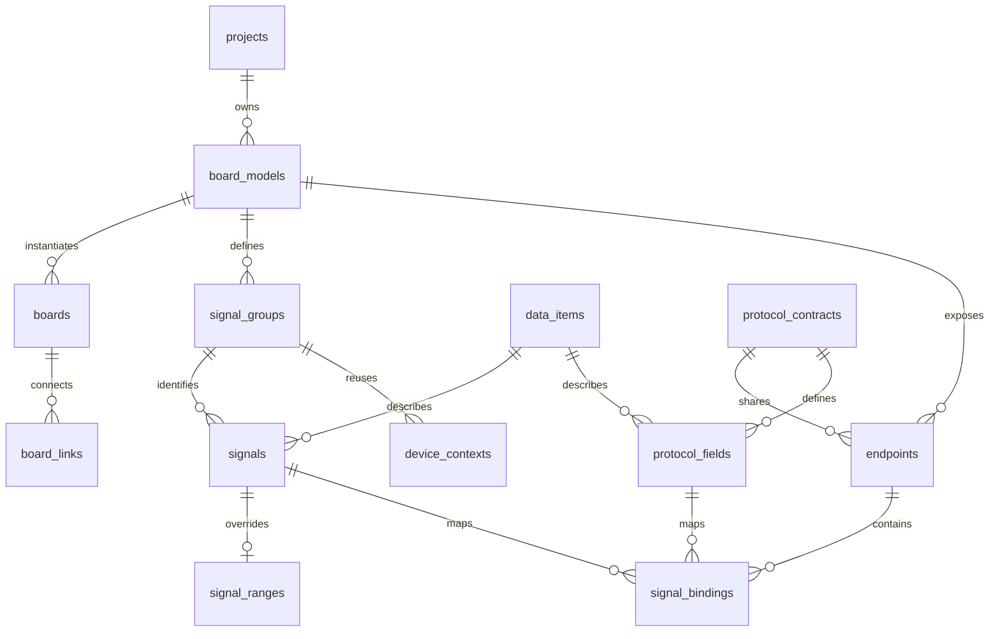
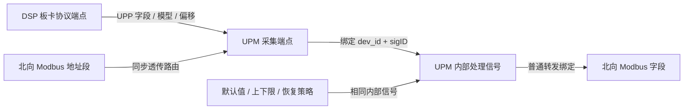

# 数据模型与派生规则

## 从工作簿分层建模

`DSP内部数据` 提供源变量，`UPM-DSP手动配置数据` 提供 ARM 侧处理/采集参数，`UPM-DSP采集数据` 是二者的投影。平台将业务定义、板内身份、协议布局和实例连接分别存储。源单元格与公式留在 `source_records`，日常编辑维护类型化字段，不改写历史来源。

- `data_items`：共享类型、字节长度、单位及默认范围。源 `F32` 与 ARM 的 `S32` 代理不是同一种内部类型；`signals.internal_type` 和 `protocol_fields.wire_type` 显式覆盖。
- `board_models / boards`：模板定义固件配置，实例定义项目里的实际板卡。同模板实例共享端点和信号；需要独立固件配置时使用不同模板。
- `signal_groups / signals`：板卡模板内的信号组及 sigID。数字 ID 与公共符号二选一；板卡对端的 sigID 不要求相同。
- `device_contexts`：固件 DP 的 dev_id。在 UPM 内，LOCAL=247，DSP1..8=11..18，VIR=1；DSP 代理组可复用于八个上下文。这些值不是 CAN 通信地址。
- `protocol_contracts / protocol_fields`：协议类型、模型、顺序、地址、字节序、读写属性、长度和精度。多端点引用同一协议契约，布局修改同时影响双方。
- `endpoints / board_links`：端点归属模板，连接落到具体板卡实例；远端通信地址和 UPP DevCode 独立设置。
- `signal_bindings`：端点/上下文/协议字段绑定到板内信号，保留轮询及优先级参数。多个北向地址可以绑定同一信号。
- `passthrough_routes`：Modbus 地址段指向 UPP 端点和设备上下文；它不同于普通 DP 转发。

界面按板卡类型聚合：「项目拓扑」页面用 CSU、UPM、DSP、变压器 IDU、整流模块 IDU 五个类型节点表示拓扑，24/8/1/4 是关系上的挂载数，拓扑节点按对应模板 ID 跳转到该板卡的内部信息，不设置单独的跳转按钮。同级「板卡内部信息」页面按板卡类型切换自己的点表和协议配置。信号、范围、端点和逻辑设备按模板筛选，采集/转发按端点角色分表。板间协议从项目 JSON 的类型挂载关系读取，原有实例和通信地址保留于关系表，不复制为板卡配置模块。图形按挂载关系计算层级和分支位置，CSU 的三个下级类型并列，DSP 继续位于 UPM 下级，不依赖类型数组顺序。两类 IDU 通过不同模板维护独立配置，与 CSU 均使用 Modbus RTU / RS485。数据定义展示本类型实际引用的子集，新定义在项目共享目录维护。

`projects.topology_config` 保存可导入/导出的 JSON 文档，结构定义在 `src/project_config.rs`，示例为 `config/project.example.json`。`board_types` 通过项目内唯一的 `model_code` 引用模板，`root` 和 `mounts` 定义有根树及每个上级的挂载数。数量不创建重复实例或信号行。JSON version 2 将每条挂载上的协议拆为 `connections` 数组；CSU ↔ UPM 同时声明 MODBUS/CANFD 和 UPP/CANFD，数量仍为 24。兼容解析 version 1 的单组协议，提交时规范化为 version 2。拓扑按挂载画连线并逐行标注协议，板间协议表按连接展开；已有端点共享契约时，所有可匹配的协议/传输组合都必须在声明中，未使用的其他接口不参与匹配。迁移 0007 为端点增加 CANFD 类型，不更改已有 CAN 或 RS485 端点。

JSON 更新通过现有变更预览/提交事务完成，校验类型唯一性、挂载可达性、数量、协议、权限和 revision。模板被 JSON 引用时不能单独删除或改代码；已有信号/端点的类型不能直接从 JSON 移除。预览与审计包括配置文档和受影响类型的挂载数量。工作簿替换导入恢复 JSON 引用的模板，防止 CSU 入口丢失。编辑器的关联选项随模板、端点、上下文变化，失效旧引用会清空，后端执行完整关系校验。

## 采集、处理、转发、range 的关系

业务点表接口由 `src/point_tables.rs` 实现，前端 `PointTable.vue` / `PointEditor.vue` 使用独立契约，不根据数据库表结构生成主业务页面。`process_points`、`collect_points`、`forward_points` 是业务操作名，不新增重复存储表；处理点写入信号及可选的范围覆盖，采集和转发写入各自角色的绑定。底层外键仍是唯一的关联依据。

显示定义在 `config/point-tables.json`：共享字段目录负责名称和控件元数据，三个点表分别声明展示列及编辑字段；Rust 白名单负责读写能力边界。返回的有效值用于显示，`edit_values` 保留真实覆盖值，包括继承用的 `null`。处理点删除与范围删除处于同一事务，被绑定引用时整体回滚；跨板卡移动、端点角色错误和协议不匹配在业务写入口直接拒绝。

点表读取在 REPEATABLE READ / READ ONLY 事务中读取 revision、记录和关联选项，避免把要求 UPDATE 权限的行锁用于只读用户。修改预览和提交保留项目锁、乐观版本检查和审计，复合修改的审计前后记录包含 range。前端按字段目录构建搜索文本索引，并在逻辑设备或端点改变后清理失效的信号与协议字段选择。

身份完整范围是“板卡实例 + dev_id + sigID”。板卡内部修改 sigID 时，采集绑定、普通转发和 range 通过外键跟随；对端板卡的 sigID 不变。range 关联内部信号，默认值/上下限可继承共享定义，也可以覆盖；上电恢复与手动恢复分别设置。

参考 AIDC 当前启用了普通 Modbus 转发及 Modbus→UPP 同步透传。`transmit_upp.c` 未在当前设备注册中启用。透传读取走协议请求，不要求每个字段都进入 ARM DP；写入路径仍需要采集解析 ID。未绑定 DP 的协议字段在生成时分配独立解析 ID，不能据此推断 DSP 固件内部 sigID。

## SQL 派生规则

定义见 `migrations/0005_topology.sql`：

| 视图 | 作用 |
| --- | --- |
| v_signals | 解析公共 sigID，合并共享定义、内部类型与 range 覆盖 |
| v_protocol_fields | 按契约/模型/寄存器区计算类型、长度和地址，遇手动锚点重新累计 |
| v_bindings | 展开端点、设备、信号和协议字段关系 |
| v_passthrough_fields | 将 UPP 字段按模型/顺序累计为每个 Modbus 窗口的寄存器地址 |
| v_topology_links | 展开板卡实例、端点、上下文和通信协议 |

UPP 偏移以字节计，普通模型默认从 6 开始，源表六个特殊字段保留显式偏移。Modbus 以 16 位寄存器计；普通转发字段必须使用偶数字节布局。透传视图按字段长度展开，检查整个窗口边界。

共享长度改变时，信号长度与未覆盖的协议长度自动变化，并重算后续自动地址；显式地址保持原值并检查重叠。存在固定类型覆盖时，编辑不能造成绑定两侧类型或长度不兼容。字段重排也会影响透传地址，应通过变更预览确认。

## 权限边界

平台管理员可以创建账号、项目和分配项目成员。工程师与只读身份按项目存储，不同项目可以为同一用户分配不同角色。工程师可以修改点表和创建版本；只读成员可以查询和下载。

认证使用 Argon2id 密码散列、随机 256 位会话、数据库仅保存令牌 SHA-256。Cookie 为 HttpOnly、SameSite=Strict；生产 HTTPS 配合 Secure。会话有效期 12 小时，禁用账号或更新账号会撤销会话。登录错误按账号限制在 15 分钟 10 次以内。

每个业务请求开始一个数据库事务，通过事务级 `set_config(..., true)` 设置用户和项目上下文。业务表启用 `FORCE ROW LEVEL SECURITY`，策略从真实用户与成员关系判断读取、写入权限。连接返回池后，事务设置不会残留。

`protocol_app` 是后端服务角色，不能是 superuser / BYPASSRLS，不拥有表；凭据不提供给前端或项目成员。RLS 的用户上下文由可信后端设置。授权函数使用固定 search_path，读取管理员和成员身份。运行账号没有审计和已发布版本的 UPDATE / DELETE 权限。

SQL 工作台执行的是 AST 校验后重新渲染的单条查询，不直接运行未解析的字符串：

- 只允许 SELECT / WITH；禁止修改语句、SELECT INTO、锁定、外部表函数。
- 业务表/视图白名单；CTE 使用作用域栈；不开放用户、会话、审计或系统目录。
- 仅允许列出的常用聚合、字符串和窗口函数；禁止 set_config、pg_sleep、文件函数和用户自定义类型转换。
- 事务只读、当前项目 RLS、3 秒超时、500 行结果上限。

## 编辑、迁移与发布

所有配置创建、修改、删除采用两步 API：`changes/preview` 在 SAVEPOINT 内实际应用并计算 SQL 视图差异，随后回滚；`changes/{id}/commit` 在项目锁下重新校验并提交。预览绑定操作者、项目 revision，15 分钟有效、只能使用一次；并发变更返回 409。预览显示受影响板卡和全部变更数量，明细最多展示 200 项。

所有跨表外键包含项目 ID，禁止跨项目引用；校验额外检查模板归属、协议端点角色、契约匹配和地址冲突。现有导入错误允许逐项修复，但新引入的阻断错误不能提交。SQL 工作台只读。

Excel 导入在同一个事务内重建整个拓扑，已有任一配置时要求明确勾选替换。上传预览绑定用户和 revision，1 小时失效。覆盖前保留完整审计快照。同一 sigID 的别名若存在不同类型、范围或处理参数会拒绝导入，避免静默合并。

迁移 `0005` 后，Rust 迁移程序将旧 `points/devices` 转为规范化模型，并设置 `projects.schema_version=2`。原点表和设备记录保留为只读档案，旧视图不再供 SQL 工作台使用。迁移保留已保存的参数，不用工作簿值覆盖用户修改；可识别的 UPM 项目附加来源记录。再次运行迁移不会重新导入。

发布在项目锁内完成校验、生成及快照保存。JSON 项目按 `board_types/<类型代码>/` 各生成一份配置，并输出 `project.json`，数量不复制生成目录；未配置 JSON 的旧项目保留 `boards/<实例代码>/` 格式。配置含设备注册、采集、处理、普通转发、range 和透传表，contract 模板输出协议契约和 XML。类型级 XML 的 DevCode 为 0（未指定实例），具体通信地址仍由实际部署配置。未明确 DSP 固件内部身份时不生成其处理表。

AIDC 目标有明确 ABI 限制（如设备地址、信号长度和点表注册数量）。已有回调函数、驱动端口、透传读写权限实现由目标固件提供；`passthrough_config.h` 与 `passthrough_fields.json` 给出新窗口和布局，目标回调须使用它们，不能继续硬编码旧地址。普通 Modbus 表没有精度转换成员，精度元数据保留在协议 JSON，数值转换须由既有业务回调承担。UPP 从机系数需要固件启用 `UPP_S_SWT_DEC_P_EN`。最小 ABI 编译测试不能代替完整固件编译及硬件联调。
