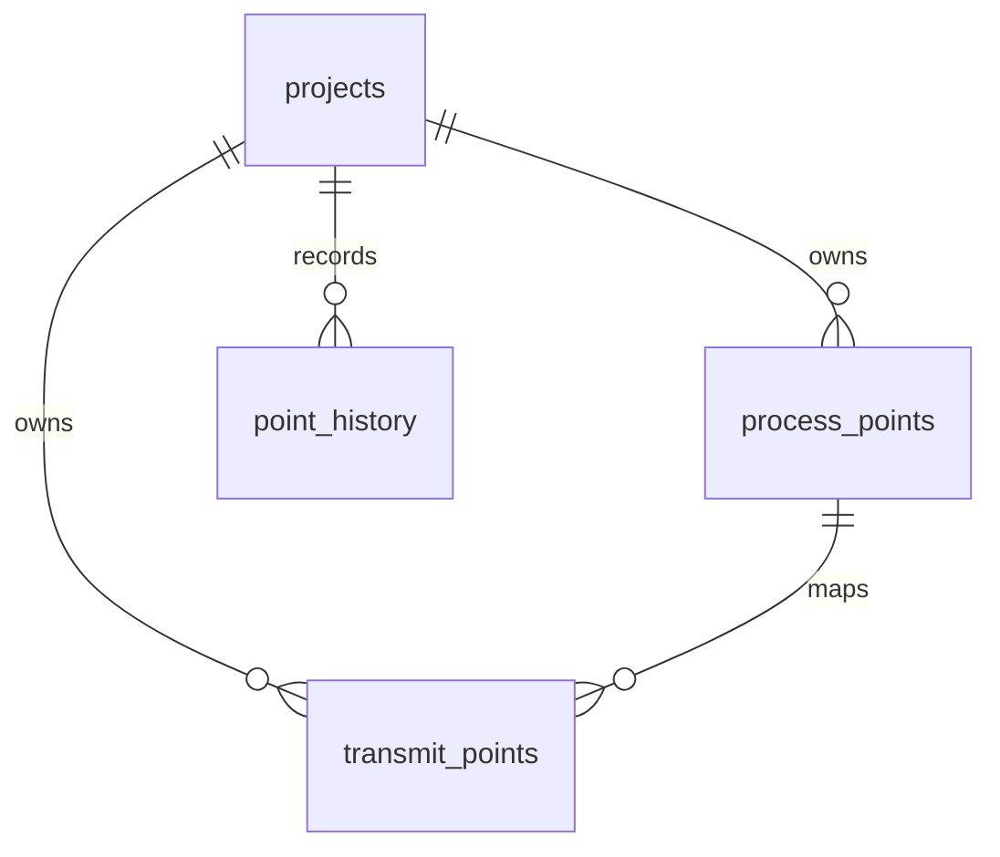

# 数据库结构与配置职责

## 结构概览

迁移 `0015_json_topology.sql` 后，public 中共 16 张表。板卡、分组、端点和挂载关系不再有独立 SQL 组织表；它们来自项目 JSON。

| 表 | 职责 |
| --- | --- |
| `process_points` | 当前 DSP 内部数据 |
| `transmit_points` | 当前 DSP UPP 转发，一条内部点可关联多条转发 |
| `point_history` | 两张业务表的追加式修改历史 |
| `projects` | 项目 ID、config_key、名称、revision、已应用 topology_config 快照 |
| `users` / `sessions` / `login_attempts` | 登录账号、会话、登录限流 |
| `project_members` / `project_member_grants` | 项目成员、板卡和端点编辑范围 |
| `project_edit_locks` | 有期限的项目编辑权 |
| `imports` / `import_previews` / `change_previews` | 导入记录、工作簿和修改预览 |
| `audit_logs` | 项目、成员、发布、导入和修改操作审计 |
| `releases` | 不可变的生成文件、数据快照及发布信息 |
| `_sqlx_migrations` | 程序迁移版本及校验和 |

`projects` 只保留系统定位和版本所需信息。`config/upm/project.json` 是 DC-UPS 的可编辑来源，`projects.topology_config` 是经过校验导入的生效快照；保留快照使编辑、权限和历史不会随着未导入的 SSH 文件改动发生变化。

## JSON 组织

```json
{
  "code": "DSP",
  "name": "DSP 功率板",
  "model_code": "DSP",
  "directory": "DSP",
  "point_storage": "native",
  "point_groups": [{"code": "LOCAL", "name": "DSP 内部数据"}],
  "point_endpoints": [{"code": "UPP_SERVICE", "name": "UPP 转发表", "protocol": "UPP"}]
}
```

此对象位于 `topology.board_types`。`code` 是稳定板卡键，`model_code` 仅保留配置及工作簿识别用途，不对应数据库模板记录。`root` 和 `mounts` 描述数量与连接，数量不会复制点表。表格显示定义由板卡目录下的三个 JSON 提供。

## 当前业务字段

所有业务行都有 `id`、`project_id`、`board_key`。ID 是数据库稳定主键，JSON 代码指定归属。

| 表 | 主要字段 |
| --- | --- |
| `process_points` | `group_key`、`name`、`enum_name`、可空 `sig_id`、`internal_type`、`element_count`、`byte_length`、`unit` |
| 内部点参数 | `default_value`、`min_value`、`max_value`、`boot_restore`、`manual_restore`、`process_enabled`、`flags`、`callback`、`notes` |
| `transmit_points` | `process_point_id`、`endpoint_key`、`name`、`upp_model`、`address`、`wire_type`、`wire_length`、`scale`、`access`、`byte_order`、`conversion`、`enabled` |
| 两表追溯信息 | `display_order`、`source_sheet`、`source_row`；内部点另有 `metadata` |



转发以 `process_point_id` 关联内部点，避免修改枚举或 sigID 时断开关系。数据库外键防止跨项目引用，应用校验确保相同板卡且端点、分组在生效 JSON 中存在。移除被数据或授权引用的配置会被拒绝。

`address` 是明确的 UPP 字节偏移，拖动行只改 `display_order`。内部 F32 与线上 S32 可使用显式 `fixed_point` 转换；数组可用 `array_bytes` 映射。未知 DSP sigID 保持空值。

## 历史、并发和发布

业务数据与历史分表：前两张存当前状态，`point_history` 按修改追加。字段包含项目、批次、记录类型/ID、板卡/分组、动作、前后 JSON、操作者、项目 revision、配置快照和时间。点删除后历史仍保留；相同值不产生点变化记录。

预览在事务内试写后回滚。提交再次校验编辑权、revision、字段冲突、关联和权限，业务修改、历史、审计及 revision 在同一事务提交。`json-patch` 比较基线与最新状态，无关字段可合并；同字段或依赖冲突不覆盖。项目编辑租约降低同时修改概率，版本检查处理过期草稿。

PostgreSQL 的事务/MVCC 不替代这些应用历史记录。运行角色不能修改或删除既有 `point_history` 和发布记录；RLS 隔离项目。`project_member_grants` 使用稳定 `board_key` / `endpoint_key`，全板卡授权覆盖内部点与该板卡协议授权。

项目 Dump 只包含两张当前业务表，导入时重新分配 ID 并重建引用，保留目标已有历史；完整账号、历史和发布迁移必须使用全库备份。旧关系图与旧 C 生成流程已移除，当前仅实现 DSP，UPM 采集留待后续。
