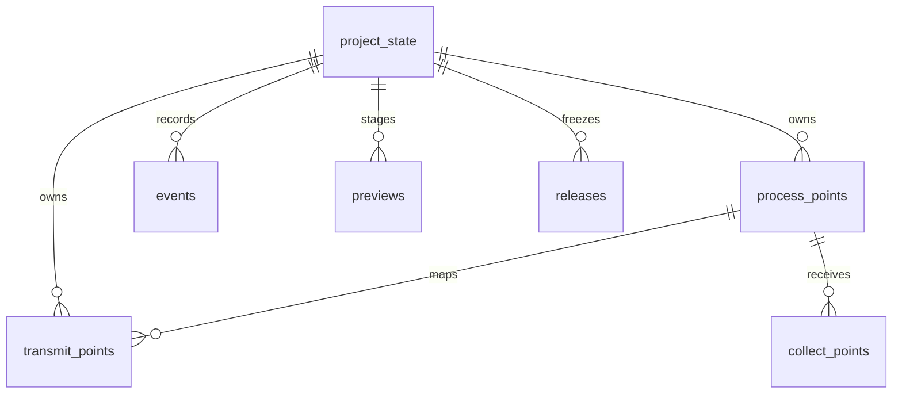

# 数据库结构与配置职责

## 结构概览

同一个 PostgreSQL 实例中，平台库与项目业务库分开。DC-UPS 使用 `protocol_project_dc_ups`，不是 UPM 项目；UPM 是 `config/dc-ups/project.json` 中的一种板卡。

| 数据库 | 表 | 职责 |
| --- | --- | --- |
| `protocol_platform` | `auth.users` / `auth.sessions` / `auth.login_attempts` | 登录账号、会话与限流 |
| 平台库 | `meta.projects` | 项目 ID、不可变 UUID、config_key、名称、数据库名和创建状态 |
| 平台库 | `meta.project_members` / `meta.project_member_grants` | 项目成员及板卡、端点编辑范围 |
| 平台库 | `history.audit_logs` | 账号、成员与权限操作审计 |
| 每项目业务库 | `points.process_points` / `points.collect_points` / `points.transmit_points` | DSP/UPM 内部点、采集与对外映射 |
| 项目库 | `history.events` | 追加式点修改、项目审计和导入事件 |
| 项目库 | `history.releases` | 不可变发布快照及生成文件 |
| 项目库 | `meta.project_state` | 单行项目身份、UUID、版本、生效配置和编辑权 |
| 项目库 | `meta.previews` | 待确认的修改或工作簿导入 |
| 每个库 | `public._sqlx_migrations` | 各自的迁移版本和校验和 |

平台库共 8 张表，每个项目库共 8 张表（包含迁移记录表）。平台按 `auth`、`meta`、`history` 分组，项目按 `points`、`history`、`meta` 分组，各自保留 `public._sqlx_migrations`。Schema 是库内分组，在 DBeaver 刷新数据库后展开即可查看；同一库的表仍共用事务并可建立外键，板卡不单独建库。业务库不保存账号密码或权限副本；历史保存操作者 ID 和名称快照，不跨数据库建用户外键。

平台保留独立成员授权表，继续用复合外键、范围检查和唯一约束防止无效或重复授权。会话支持多设备和独立过期；登录尝试也要记录不存在的用户名，因此这两类记录不合入账号表。平台审计只追加，与可更新的账号、权限和项目状态分别保存。

`config/dc-ups/project.json` 是可编辑来源，业务库 `meta.project_state.topology_config` 是校验导入后的生效快照。平台登记仅负责定位项目，不能用 JSON 中任意数据库地址替换路由。路由同时核验项目 ID、key 和 UUID，避免同名数据库被误用。

## JSON 组织

```json
{
  "code": "DSP",
  "name": "DSP 功率板",
  "model_code": "DSP",
  "directory": "DSP",
  "point_storage": "native",
  "point_groups": [{"code": "LOCAL", "name": "DSP 内部数据"}],
  "point_endpoints": [{"code": "UPP_SERVICE", "name": "UPP 转发表", "protocol": "UPP"}]
}
```

此对象位于 `topology.board_types`。`code` 是稳定板卡键，`model_code` 仅保留配置及工作簿识别用途，不对应数据库模板记录。拓扑版本 3 使用 `roots` 和 `mounts` 描述多个根及共享下级，兼容旧版本的 `root` 单根树。不同上级指向同一节点时引用同一组设备，总数量须一致，不能重复累计；数量不会复制点表。表格显示定义由板卡目录下的三个 JSON 提供。

拓扑图使用 ELK.js 分层布局，默认平滑曲线，可切换直角折线；数量和协议显示为无框文字。节点位置、边路径和协议标签统一计算，曲线按引擎返回的三次贝塞尔控制点绘制。引擎及 Worker 按需加载；输入按稳定键排序，与 JSON 数组顺序无关。方向、线型切换和自动整理仅改变当前浏览器视图，不修改拓扑或 revision。共享子节点仍只绘制一次。

## 当前业务字段

所有业务行都有 `id`、`project_id`、`board_key`。ID 是库内稳定主键；不同项目可有相同 ID，完整身份包含项目。JSON 代码指定板卡归属。

| 表 | 主要字段 |
| --- | --- |
| `points.process_points` | `group_key`、`name`、`enum_name`、可空 `sig_id`、`internal_type`、`element_count`、`byte_length`、`unit` |
| 内部点参数 | `default_value`、`min_value`、`max_value`、`boot_restore`、`manual_restore`、`process_enabled`、`flags`、`callback`、`notes` |
| `points.transmit_points` | `process_point_id`、`endpoint_key`、`name`、`upp_model`、`address`、`wire_type`、`wire_length`、`scale`、`access`、`byte_order`、`conversion`、`enabled` |
| `points.collect_points` | `process_point_id`、`endpoint_key`、`upp_model`、`address`、`wire_type`、`wire_length`、`scale`、`access`、`byte_order`、`acquisition_mode`、`poll_interval`、`set_priority`、`scan_priority` |
| 三表追溯信息 | `display_order`、`source_sheet`、`source_row`、`metadata`；转发另有 `register_type` |



转发以 `process_point_id` 关联内部点，修改变量名不会断开关系。数据库外键防止跨项目引用，应用校验确保相同板卡且端点、分组在生效 JSON 中存在。移除被数据或授权引用的配置会被拒绝。

`address` 是明确的 UPP 字节偏移，拖动行只改 `display_order`。DSP 转换自动确定：同类型为 `identity`，内部 F32 与线上 S32 为 `fixed_point`，数组到 STRING 为 `array_bytes`；长度、系数及类型组合仍须通过校验。DSP 不提供转换方式和字节序的独立输入。通用 `conversion`、`byte_order` 列保留兼容其他板卡和旧 Dump；DSP 写入、读取及生成使用自动转换结果，字节序兼容值为 0，旧值不影响 DSP 校验和生成。字节序属于接收端配置，在 UPM 协议表中独立维护。DSP 内部没有 sigID；通用存储中的可空 `sig_id` 仅为兼容字段，不属于 DSP sheet 的显示或编辑定义。

原工作簿 `UPM-DSP采集数据!O2` 按型号分段计算偏移：常规字段为 `6 + 同型号前面各行的通信字节数之和`，每个型号重新起算。六个名称使用固定偏移：固件版本号版本 48、机器型号 8、机器版本号 24、序列号 62、机器型号编码 94、设备类型编码 96。导入保留 Excel 已计算的 O 列结果；DSP 网页写入由 `transmit.json.calculation` 引用的 `transmit.js` 和 JSON 参数计算字节数和偏移。默认规则按模型升序、上传等级降序、稳定来源顺序计算，复现上述公式；固定地址行的长度仍计入累计量。界面 `effective_address`（UPP偏移地址）和导出 XML 的 `OffsetAddr` 均直接使用 `address`，不再加帧头或型号。相同板卡、端点及型号内，DSP 所有转发字段的 `[address, address + wire_length)` 区间不能重叠；不同型号可以使用相同偏移。

DSP 保留原 sheet 的 25 个来源字段，`process.json` 在界面隐藏“数据类型”和“UPP 模型号”。`variable_name` 映射 `metadata.source_variable`，同步规范化的 `enum_name`；`sheet_type` 将 `Sys_U16` 等映射为 `internal_type`。`EnumTab`、显示位数、存储标志、STRUCT、CPU、上传等级和分类逐字段写入 `metadata` 白名单；RAM/FLASH/EEPROM/Calibration 与恢复默认值等旧布尔字段无关。原始 `source_cells` 保持不变用于追溯，网页读取当前业务值。

DSP 转发的 `upp_model` 保留为存储字段，服务端固定由内部 `category` 推导；禁止独立改成其他型号。分类变更在同一事务更新全部关联映射，现有预览、权限、版本冲突和历史记录覆盖型号和布局联动；计算后地址碰撞会使整个修改回滚。没有分类的内部点可独立存在，但不能建立转发。工作簿与 Dump 导入同样校验型号一致性。

DSP 分类与型号对应：系统参数1 → 1，系统参数2 → 2，任务级观测量 → 99，中断级观测量 → 100，控制参数设置 → 102，任务级标定量 → 103。

DSP 转发表按“数据名称、VariateName、数据分类、UPP模型号、UPP偏移地址、UPP协议字节数、数据类型”显示主要字段。前两列名称与内部表一致，型号只读；协议字节数使用实际 `wire_length`，不重复显示内部 `byte_length`。不再提供独立转发名称和启用开关：名称在读取及生成时取关联内部点当前 `name`；存在的映射全部参加校验及协议生成，停止转发通过删除映射并保留历史完成。通用存储中的 `name`、`enabled` 保留兼容其他板卡与旧 Dump，DSP 新写入规范为来源名称及 `true`，旧 `false` 也不能跳过校验或 XML 导出。此修改无需数据库迁移。

`wire_type` 是每条转发可编辑的实际通信类型。转发表隐藏内部来源 `DateType` 列，保留实际通信“数据类型”列；隐藏的来源字段仍供建议推导使用。数组建议 `STRING`，标量 `F32` 建议 `S32`，其他沿用类型；新增时补齐缺省通信参数。合法人工覆盖产生非阻断提示，例如 F32 内部点以 `F32 / identity / scale=1` 转发；不支持的转换仍拒绝。修改 `DateType` 只改变建议，不覆盖已有实际类型。转发表使用 `category` 筛选，按端点及派生型号进行组内排序。此调整不增加数据库表或改变其他板卡规则。

## 统一历史事件

`history.events` 按 `kind` 区分事件，业务表只保存当前状态：

| kind | 内容及字段 |
| --- | --- |
| `point` | 单个点的 `entity_type`、`record_id`、板卡/分组、`action`（insert/update/delete）、前后 JSON、批次、配置快照及项目版本 |
| `audit` | 项目操作的 `action`、`entity`、前后内容，例如创建项目、导入配置、发布 |
| `import` | `action=import.complete`，`metadata` 保存文件名、SHA-256 和校验报告 |

公共字段包括 `id`、`project_id`、`actor_id`、`actor_name`、`created_at`。同次点修改使用同一个 `batch_id`；删除点仍保留历史，相同值不产生点变化事件。发布快照保存在独立的 `history.releases`，避免混入每次编辑的差异记录。

旧 `point_history`、项目 `audit_logs`、`imports` 完整迁入统一事件表，`legacy_source` / `legacy_id` 保存原表名和原 ID；点历史 ID 保持不变，旧审计和导入获得新的事件 ID。旧审计和导入没有记录项目版本，迁移后 `project_revision` 保持空值；新事件记录实际提交版本。平台库的 `history.audit_logs` 仍独立保留。

```sql
SELECT * FROM history.events WHERE kind = 'point' ORDER BY id DESC LIMIT 100;
SELECT metadata FROM history.events WHERE kind = 'import' ORDER BY id DESC;
```

## 项目状态、预览与并发

`meta.project_state` 每项目只有一行，包含身份、`revision`、`schema_version` 和 `topology_config`。原独立编辑锁并入 `edit_owner_id`、`edit_owner_name`、`edit_owner_username`、`edit_expires_at`；数据库统一仲裁编辑权，到期或提交后释放。租约续期不增加业务 revision，锁字段不出现在项目导出或发布快照中。

`meta.previews` 允许同项目同时存在多条预览，`kind=change` 存修改内容及 `merge_base` / `merge_patch`，`kind=import` 存解析后的工作簿以及文件名、SHA-256。每条记录带创建人、基准版本和到期时间；修改预览 15 分钟、工作簿预览 1 小时有效。查询、提交和删除同时检查项目、种类及创建人，不能拿导入预览提交修改，也不能清除他人的预览。

预览在事务内试写后回滚。提交再次校验编辑权、revision、字段冲突、关联和权限，业务修改、历史、审计及 revision 在同一事务提交。`json-patch` 比较基线与最新状态，无关字段可合并；同字段或依赖冲突不覆盖。项目编辑租约降低同时修改概率，版本检查处理过期草稿。

PostgreSQL 的事务/MVCC 不替代这些应用历史记录。运行角色不能修改或删除既有事件和发布记录；RLS 校验当前项目与事务内权限。服务器先在平台库锁定账号及项目权限，再把授权快照设置到业务事务；直到业务提交完成才释放平台锁。撤权与提交按锁顺序执行，数据库不使用跨库用户查询。`meta.project_member_grants` 使用稳定 `board_key` / `endpoint_key`，全板卡授权覆盖内部点与该板卡协议授权。

## 升级与项目归档

平台迁移 `migrations/platform/0002_grouped_platform.sql` 将七张业务/运行表从 `public` 移入对应 Schema，表数、记录、ID、序列、外键、权限范围约束及登录会话保留。它将平台库的 `public._sqlx_migrations` 更新到版本 2，本身不改动项目库的表、`schema_version` 或业务 `revision`；两类版本各自管理。代码与手写 SQL 使用 Schema 限定名，安全函数和运行角色授权同步适配。

项目迁移 `0002_grouped_project.sql` 将现有库整理为 7 张表，完整保留点数据、历史、发布和已有编辑权。旧预览全部失效，现有项目 `revision` 增加 1，`schema_version` 更新为 5。刷新客户端后重新检查待提交草稿；不要删除 `_sqlx_migrations` 或修改已应用的迁移文件。

项目迁移 `0003_upm_collection.sql` 增加采集表和 Modbus 转发属性，项目库变为 8 张表、`schema_version=6`，旧预览失效且 revision 增加 1。组织、权限与历史继续沿用现有结构。UPM 的 LOCAL/DSP 模板及设备地址规则见 [UPM 点表](upm.md)。

项目 Dump 包含三张当前业务表，导入重新分配 ID 并重建引用，保留目标已有历史。新归档为 `(7,4)`，兼容 `(6,3)` 及旧 `(4,1)`、`(5,2)` 两表归档（采集为空）；只解析白名单数据，不执行上传 SQL。完整迁移仍需同时备份平台库、各项目库和 config 并保留 UUID。

## JSON、表行为与布局计算

每张表可用 `behavior` 指向板卡目录内的 JS。Rust 保留身份、存储、协议安全和事务能力；JS 的 `normalize`、`project`、`reconcile`、`validate` 负责本表的输入转换、展示、联动和业务校验。可编辑自定义字段写入声明过的 `metadata` 子键，展示列通过 JSON `fields` / `presentation` 渲染。DSP 的工作表别名、分类模型和建议通信表示已移入 `process.js`，转发名称、转换及分类联动位于 `transmit.js`，没有基于板卡名称的分派。接口见 [点表行为脚本](table-behavior.md)。

DSP 转发表还使用 `calculation: {engine: "javascript", script_file: "transmit.js", parameters: ...}`。同一文件默认导出布局函数，命名导出表行为；布局只输出 `id` / `address` / `wire_length`。兼容的 `builtin` 引擎继续支持 JSON 分组、排序与固定偏移。脚本路径限定于板卡目录，加载后把正文加入预览规则快照；修改 JS 文件也会使旧预览失效。布局契约详见 [点表计算](table-calculation.md)。

变更预览冻结脚本和参数；提交重新读取配置并比较，变更后需重新预览。单行及批量写入完成后在同一事务联动声明字段、计算布局并同步来源关系，权限检查覆盖全部受影响记录。返回值、影响预览和点历史使用最终状态；审计事件保存所用规则。并发修改通过现有三方比较及重放检查处理，新增关联行扩大影响时拒绝旧预览。

读表、加载配置和文件夹无 Dump 导入不改点数据。Excel / Dump 导入保留导入值，后续显式重算或点表编辑的预览才能改变布局。校验、生成和发布会检查已保存布局是否符合当前计算规则，尚未同步时阻止生成。运行限制和失败校验位于后端，脚本不能改变记录身份、权限、来源证据或历史，也不能连接数据库或访问文件。新增项目可复用现有点模型、协议和控件；全新协议编码、固件文件格式或存储关系仍可能需要扩展通用引擎。
