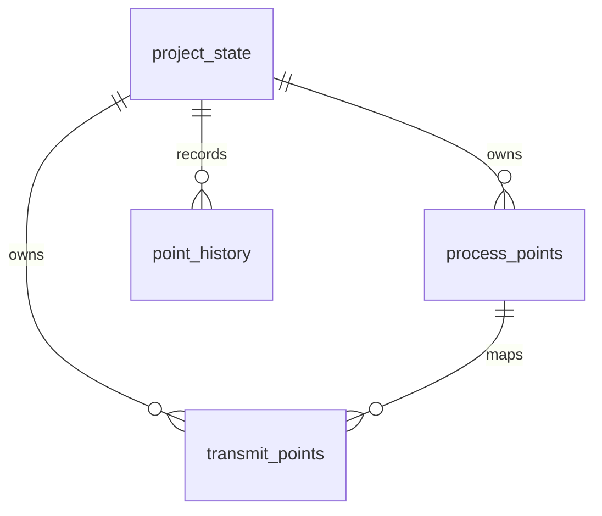

# 数据库结构与配置职责

## 结构概览

同一个 PostgreSQL 实例中，平台库与项目业务库分开。DC-UPS 使用 `protocol_project_dc_ups`，不是 UPM 项目；UPM 是 `config/dc-ups/project.json` 中的一种板卡。

| 数据库 | 表 | 职责 |
| --- | --- | --- |
| `protocol_platform` | `users` / `sessions` / `login_attempts` | 登录账号、会话与限流 |
| 平台库 | `projects` | 项目 ID、不可变 UUID、config_key、名称、数据库名和创建状态 |
| 平台库 | `project_members` / `project_member_grants` | 项目成员及板卡、端点编辑范围 |
| 平台库 | `audit_logs` | 成员与权限操作审计 |
| 每项目业务库 | `project_state` | 单行项目身份、UUID、revision、schema_version、生效 topology_config |
| 项目库 | `process_points` / `transmit_points` | 当前 DSP 内部数据及 UPP 转发映射 |
| 项目库 | `point_history` | 业务行的追加式修改历史 |
| 项目库 | `project_edit_locks` | 有期限的编辑权，持有人名称快照 |
| 项目库 | `imports` / `import_previews` / `change_previews` | 导入记录及修改预览 |
| 项目库 | `audit_logs` / `releases` | 项目操作审计、不可变发布快照 |
| 每个库 | `_sqlx_migrations` | 各自的迁移版本和校验和 |

平台库共 8 张表，每个项目库共 11 张表（包含迁移记录表）。组织配置没有独立 SQL 表，板卡也不单独建库。业务库不保存账号密码或权限副本；历史记录保存操作者 ID 和名称快照，不跨数据库建用户外键。

`config/dc-ups/project.json` 是可编辑来源，业务库 `project_state.topology_config` 是校验导入后的生效快照。平台登记仅负责定位项目，不能用 JSON 中任意数据库地址替换路由。路由同时核验项目 ID、key 和 UUID，避免同名数据库被误用。

## JSON 组织

```json
{
  "code": "DSP",
  "name": "DSP 功率板",
  "model_code": "DSP",
  "directory": "DSP",
  "point_storage": "native",
  "point_groups": [{"code": "LOCAL", "name": "DSP 内部数据"}],
  "point_endpoints": [{"code": "UPP_SERVICE", "name": "UPP 转发表", "protocol": "UPP"}]
}
```

此对象位于 `topology.board_types`。`code` 是稳定板卡键，`model_code` 仅保留配置及工作簿识别用途，不对应数据库模板记录。`root` 和 `mounts` 描述数量与连接，数量不会复制点表。表格显示定义由板卡目录下的三个 JSON 提供。

## 当前业务字段

所有业务行都有 `id`、`project_id`、`board_key`。ID 是库内稳定主键；不同项目可有相同 ID，完整身份包含项目。JSON 代码指定板卡归属。

| 表 | 主要字段 |
| --- | --- |
| `process_points` | `group_key`、`name`、`enum_name`、可空 `sig_id`、`internal_type`、`element_count`、`byte_length`、`unit` |
| 内部点参数 | `default_value`、`min_value`、`max_value`、`boot_restore`、`manual_restore`、`process_enabled`、`flags`、`callback`、`notes` |
| `transmit_points` | `process_point_id`、`endpoint_key`、`name`、`upp_model`、`address`、`wire_type`、`wire_length`、`scale`、`access`、`byte_order`、`conversion`、`enabled` |
| 两表追溯信息 | `display_order`、`source_sheet`、`source_row`；内部点另有 `metadata` |



转发以 `process_point_id` 关联内部点，避免修改枚举或 sigID 时断开关系。数据库外键防止跨项目引用，应用校验确保相同板卡且端点、分组在生效 JSON 中存在。移除被数据或授权引用的配置会被拒绝。

`address` 是明确的 UPP 字节偏移，拖动行只改 `display_order`。内部 F32 与线上 S32 可使用显式 `fixed_point` 转换；数组可用 `array_bytes` 映射。未知 DSP sigID 保持空值。

## 历史、并发和发布

业务数据与历史分表：前两张存当前状态，`point_history` 按修改追加。字段包含项目、批次、记录类型/ID、板卡/分组、动作、前后 JSON、操作者、项目 revision、配置快照和时间。点删除后历史仍保留；相同值不产生点变化记录。

预览在事务内试写后回滚。提交再次校验编辑权、revision、字段冲突、关联和权限，业务修改、历史、审计及 revision 在同一事务提交。`json-patch` 比较基线与最新状态，无关字段可合并；同字段或依赖冲突不覆盖。项目编辑租约降低同时修改概率，版本检查处理过期草稿。

PostgreSQL 的事务/MVCC 不替代这些应用历史记录。运行角色不能修改或删除既有 `point_history` 和发布记录；RLS 校验当前项目与事务内权限。服务器先在平台库锁定账号及项目权限，再把授权快照设置到业务事务；直到业务提交完成才释放平台锁。撤权与提交按锁顺序执行，数据库不使用跨库用户查询。`project_member_grants` 使用稳定 `board_key` / `endpoint_key`，全板卡授权覆盖内部点与该板卡协议授权。

项目 Dump 只包含两张当前业务表，导入时重新分配 ID 并重建引用，保留目标已有历史；完整迁移必须停写，分别备份平台库、各项目库和 config 目录，并一起恢复，保留相同 UUID。旧关系图与旧 C 生成流程已移除，当前仅实现 DSP，UPM 采集留待后续。
