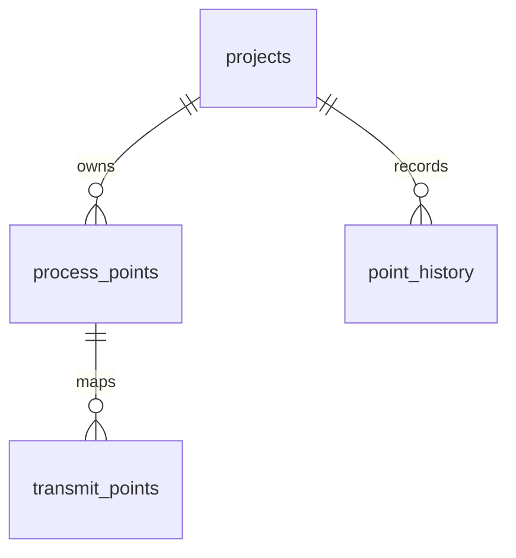
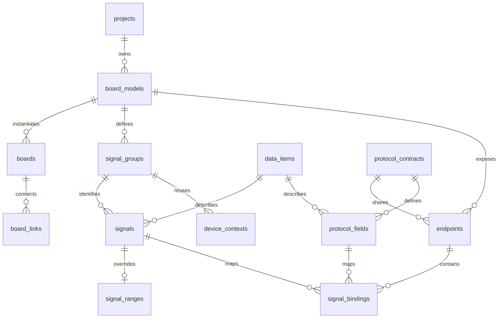
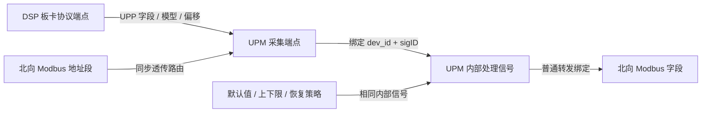

# 数据模型与派生规则

## DSP 原生点表：迁移 0014

DSP 已使用独立的业务存储，其他板卡继续使用下文的旧版关系图模型。项目清单顶层配置 `"workbook_boards": ["DSP"]` 后，CLI 创建项目只导入 DSP；它读取 `DSP内部数据` 和 `UPM-DSP采集数据` 两个 sheet，不创建 UPM 处理或采集数据。本仓库工作簿包含 552 个 DSP 内部点、445 条转发记录，107 个内部点没有转发映射。



| 存储 | 内容 |
| --- | --- |
| `process_points` | 板卡和分组 key、名称、枚举、可空 sigID、内部类型、元素数、总字节数、单位、默认值、上下限、恢复策略、处理标志及来源元数据 |
| `transmit_points` | 固定内部点 ID、输出接口 key、UPP 模型、显式偏移、通信类型和长度、系数、读写属性、字节序、转换方式、启用状态及来源位置 |
| `point_history` | 修改批次、操作者及名称快照、项目版本、对象身份、修改前后完整记录、配置前后快照和时间；只追加 |

`transmit_points` 通过包含项目、板卡的复合外键引用内部点，允许多个转发记录对应一个内部点；修改枚举或 sigID 不改变引用。`UPM-DSP采集数据` 当前作为 DSP 对外 UPP 布局来源，后续 UPM 采集端可复用这个协议定义；本次没有实现 UPM 的新采集存储或双端联动。

板卡和分组的编辑来源是 `project.json`，DSP 配置示例：

```json
{
  "code": "DSP",
  "name": "DSP 功率板",
  "model_code": "DSP",
  "directory": "DSP",
  "point_storage": "native",
  "point_groups": [{ "code": "LOCAL", "name": "本地内部数据" }]
}
```

该对象位于 `topology.board_types`。点记录通过 `board_key`、`group_key` 对应已应用的配置，不依赖旧 `signal_groups`、`data_items` 或 `signal_ranges`。`projects`、`board_models` 仍保留项目身份、生效快照和现有权限目录；此次没有删除其他板卡依赖的组织表。配置变更需要导入，不能只修改文件就使已有点失去归属。

固定内部类型的总字节数由类型大小乘元素数得到；`STRING` 的元素数表示字节容量，默认字符串按 UTF-8 字节检查。内部 `F32` 与通信 `S32` 使用显式 `fixed_point` 转换：`wire = round(internal / scale)`，反向为 `internal = wire * scale`。`identity` 要求类型、长度一致且系数为 1；`array_bytes` 保留数组的总字节数并使用 `STRING` 通信表示。转换声明随导出保存，固件仍需实现对应编码。

DSP sheet 未提供已确认的数字 sigID，导入保留空值，用枚举匹配来源、固定记录 ID 保存关联。生成器输出 `board_types/DSP/process.json`、`transmit.json` 和 `UPP_SERVICE.xml`，用于数据定义和协议交付；不推断 DSP 固件编号，也不生成未经确认的 DSP C ABI。

DSP 继续使用设置弹窗、单元格编辑、批量操作、显示排序、项目编辑租约和版本冲突检查。范围直接属于内部点，不再继承共享定义。保留原工作簿中未修改的范围异常和未解析符号时给出警告；新增越界默认值或新填入的未解析符号会阻止提交。DSP 行拖动只修改 `display_order`，不会重新计算通信偏移；列隐藏、冻结和顺序仍属于浏览器本地视图。

业务修改和 `point_history` 在同一事务提交，批量修改共用一个批次；预览、失败提交不留下成功修改历史。历史不关联可删除的点记录，删除点、重新导入和项目 Dump 替换都保留已有历史。新业务表进入项目快照、不可变发布和项目 Dump；`point_history` 不随项目业务 Dump 导出或覆盖，完整历史迁移需全库备份。RLS、成员范围检查、编辑锁和项目 revision 继续生效。

## 旧版工作簿关系图模型

本节及下文标记为旧版的派生规则适用于未设置 `point_storage: "native"` 的板卡。它们保留原 UPM/ARM 行为，不是新 DSP 表的存储结构。



`DSP内部数据` 提供源变量，`UPM-DSP手动配置数据` 提供 ARM 侧处理/采集参数，`UPM-DSP采集数据` 是二者的投影。平台将业务定义、板内身份、协议布局和实例连接分别存储。源单元格与公式留在 `source_records`，日常编辑维护类型化字段，不改写历史来源。

- `data_items`：共享类型、字节长度、单位及默认范围。源 `F32` 与 ARM 的 `S32` 代理不是同一种内部类型；`signals.internal_type` 和 `protocol_fields.wire_type` 显式覆盖。
- `board_models / boards`：模板定义固件配置，实例定义项目里的实际板卡。同模板实例共享端点和信号；需要独立固件配置时使用不同模板。
- `signal_groups / signals`：板卡模板内的信号组及 sigID。数字 ID 与公共符号二选一；板卡对端的 sigID 不要求相同。
- `device_contexts`：固件 DP 的 dev_id。在 UPM 内，LOCAL=247，DSP1..8=11..18，VIR=1；DSP 代理组可复用于八个上下文。这些值不是 CAN 通信地址。VIR 是转发服务上下文，不是独立点表分组；AIDC 板卡有启用的服务端接口且没有显式虚拟上下文时，由生成器派生 `CFG_DEV_VIR / dev_id=1`，不写入数据库。已有虚拟上下文继续使用其配置；默认编号/代码冲突和多个虚拟上下文由统一校验拒绝。
- `protocol_contracts / protocol_fields`：协议类型、模型、顺序、地址、字节序、读写属性、长度和精度。多端点引用同一协议契约，布局修改同时影响双方。
- `endpoints / board_links`：端点归属模板，连接落到具体板卡实例；远端通信地址和 UPP DevCode 独立设置。
- `signal_bindings`：端点/上下文/协议字段绑定到板内信号，保留轮询及优先级参数。多个北向地址可以绑定同一信号。
- `passthrough_routes`：Modbus 地址段指向 UPP 端点和设备上下文；它不同于普通 DP 转发。

界面按板卡类型聚合：「项目拓扑」页面用 CSU、UPM、DSP、变压器 IDU、整流模块 IDU 五个类型节点表示拓扑，24/8/1/4 是关系上的挂载数，拓扑节点按对应模板 ID 跳转到该板卡的内部信息，不设置单独的跳转按钮。同级「板卡内部信息」页面按板卡类型切换自己的点表和协议配置。信号、范围、端点和逻辑设备按模板筛选，采集/转发按端点角色分表。板间协议从项目 JSON 的类型挂载关系读取，原有实例和通信地址保留于关系表，不复制为板卡配置模块。图形按挂载关系计算层级和分支位置，CSU 的三个下级类型并列，DSP 继续位于 UPM 下级，不依赖类型数组顺序。两类 IDU 通过不同模板维护独立配置，与 CSU 均使用 Modbus RTU / RS485。数据定义展示本类型实际引用的子集，新定义在项目共享目录维护。

`projects.topology_config` 保存已通过校验并导入的拓扑快照；编辑来源是服务器 `project.json`，数据库快照用于运行、关联校验和版本追溯。结构定义在 `src/project_config.rs`，项目模板位于 `config/upm/project.json` 的 `topology`。`board_types` 通过项目内唯一的 `model_code` 引用模板，并用 `directory` 指向项目内的板卡表格目录，`root` 和 `mounts` 定义有根树及每个上级的挂载数。数量不创建重复实例或信号行。JSON version 2 将每条挂载上的协议拆为 `connections` 数组；CSU ↔ UPM 同时声明 MODBUS/CANFD 和 UPP/CANFD，数量仍为 24。兼容解析 version 1 的单组协议，提交时规范化为 version 2。拓扑按挂载画连线并逐行标注协议，板间协议表按连接展开；已有端点共享契约时，所有可匹配的协议/传输组合都必须在声明中，未使用的其他接口不参与匹配。迁移 0007 为端点增加 CANFD 类型，不更改已有 CAN 或 RS485 端点。

拓扑源由服务器项目文件维护，网页只读加载源文件，检查差异后通过现有变更预览/提交事务导入数据库，校验类型唯一性、挂载可达性、数量、协议、权限和 revision。模板被 JSON 引用时不能单独删除或改代码；已有信号/端点的类型不能直接从 JSON 移除。预览与审计包括配置文档和受影响类型的挂载数量。工作簿替换导入恢复 JSON 引用的模板，防止 CSU 入口丢失。编辑器的关联选项随模板、端点、上下文变化，失效旧引用会清空，后端执行完整关系校验。

## 采集、处理、转发、range 的关系

业务点表接口由 `src/point_tables.rs` 实现，前端 `PointTable.vue` / `PointEditor.vue` 使用独立契约，不根据数据库表结构生成主业务页面。`process_points`、`collect_points`、`forward_points` 是 API 业务操作名：旧版板卡将处理点写入信号及可选范围覆盖，将采集和转发写入各自角色的绑定；原生 DSP 则分派到 `dsp_points.rs` 的真实 `process_points` / `transmit_points` 表。底层外键是关联依据。旧版界面以 LOCAL、DSP 等点表分组组织编辑，处理点的转发配置入口筛选并维护同一份绑定。VIR 从启用的对外接口派生注册，转发数据来自既有映射，不复制处理点。

显示定义随项目保存在 `config/<项目名>/`，通过 `projects.config_key` 关联，项目显示名与目录关联独立。`project.json` 包含名称、拓扑、可选工作簿和 Dump 路径以及 `workspace`；`topology.board_types[].directory` 明确指定各板卡在本项目内的目录。每个板卡目录分别提供 `process.json`、`collect.json`、`transmit.json`，其中 `transmit` 对应原有 `forward` 业务操作。所有路径限制在所属项目内，项目加载不依赖公共定义或覆盖层。

各表完整提供 `version: 1`、`enabled`、`label`、`description`、`columns`、`editor`、`ordering`、`inline`、`fields`；`fields` 只包含该表支持的字段元数据，`inline: {}` 表示不开放单元格编辑。项目清单的 `workspace.boards` 明确列出各板卡的业务表与辅助表顺序，单表文件控制业务表启用状态和名称。隐藏入口不改变数据或权限。后端启动及后续读取时检查项目清单、目录、表文件及字段契约，缺失配置立即报错；修改展示定义后刷新页面即可生效。

项目通过服务器命令 `create-project <key>` 或管理员网页文件夹导入创建，以 `config_key` 关联目录。`GET /api/project-templates` 读取当前目录列表，`GET /api/projects/{pid}/configuration/source` 实时返回 `{key, config, sha256}`。SSH 修改后的拓扑在网页只读显示，经差异预览和提交更新数据库；处理、采集、转发点表仍可在网页编辑。新增项目、板卡、目录与展示定义无需重启。数据库仍保留项目身份、板卡模板、拓扑生效快照及业务关系；配置目录中的 JSON 不保存实际点表行。

Rust 白名单负责读写能力边界。返回的有效值用于显示，`edit_values` 保留真实编辑值；旧版包含继承用的 `null`，原生 DSP 的可空文本输入则规范为空字符串。旧版处理点删除与范围删除处于同一事务，被绑定引用时整体回滚；跨板卡移动、端点角色错误和协议不匹配在业务写入口直接拒绝。

单元格网格由 `usePointGrid.ts` 管理选择、编辑、区域剪贴板和本地撤销历史，`pointGrid.ts` 处理类型转换和草稿显示。草稿按稳定记录 ID 保存字段增量，引用字段通过合法选项及依赖关系解析，显示投影不改变数据库记录。`inline` 定义可直接编辑的字段；完整设置弹窗保留创建、删除和高级字段入口。复制时携带应用内部的字段/原值元数据以保留 null 继承和关联 ID，跨应用的文本粘贴仍需逐格类型与引用校验。

多行编辑通过 `point_batch` 的 `operation:update` 生成一个预览，保存每行原始值并采用现有三方差异合并。所有修改、范围记录和关联视图在同一项目锁和事务中校验、提交，一次增加一个 revision 并保存一份包含全部行的审计。存在冲突或校验错误时不保存任何一行；前端保留草稿。PostgreSQL 即时唯一约束仍有效，不能用批量更新直接交换两个已有 sigID 等唯一键。

`0011_string_value_ranges.sql` 修正有效信号视图：有效内部类型为 STRING 时不返回数值上下限；迁移本身不改历史行。`value_ranges.rs` 在业务写入时拒绝字符串上下限、在类型切换事务内清空失效覆盖；默认字符串和字节长度校验保留。显式使用数值内部类型的信号不受其他字符串信号的范围清理影响。

`0012_project_edit_locks.sql` 增加项目编辑租约表，启用并强制 RLS。配置写事务先锁定项目行，再验证当前用户持有有效的 120 秒租约；获取/续租/释放也使用相同项目行锁。配置提交、导入和发布在同一事务释放租约，失败回滚保留租约。无效账号或失去写权限的持有人不再阻止接管；成员管理属于独立管理通道。前端 `useProjectEditLock.ts` 管理只读模式、显式获取、心跳、提交后的状态刷新和旧响应隔离；服务器校验始终是写权限依据。

点表读取在 REPEATABLE READ / READ ONLY 事务中读取 revision、记录和关联选项，避免把要求 UPDATE 权限的行锁用于只读用户。修改预览和提交保留项目锁、乐观版本检查和审计，复合修改的审计前后记录包含 range。前端按字段目录构建搜索文本索引，并在逻辑设备或端点改变后清理失效的信号与协议字段选择。



身份完整范围是“板卡实例 + dev_id + sigID”。板卡内部修改 sigID 时，采集绑定、普通转发和 range 通过外键跟随；对端板卡的 sigID 不变。range 关联内部信号，默认值/上下限可继承共享定义，也可以覆盖；上电恢复与手动恢复分别设置。

参考 AIDC 当前启用了普通 Modbus 转发及 Modbus→UPP 同步透传。`transmit_upp.c` 未在当前设备注册中启用。透传读取走协议请求，不要求每个字段都进入 ARM DP；写入路径仍需要采集解析 ID。未绑定 DP 的协议字段在生成时分配独立解析 ID，不能据此推断 DSP 固件内部 sigID。

## 旧版 SQL 派生规则

定义见 `migrations/0005_topology.sql`：

| 视图 | 作用 |
| --- | --- |
| v_signals | 解析公共 sigID，合并共享定义、内部类型与 range 覆盖 |
| v_protocol_fields | 按契约/模型/寄存器区计算类型、长度和地址，遇手动锚点重新累计 |
| v_bindings | 展开端点、设备、信号和协议字段关系 |
| v_passthrough_fields | 将 UPP 字段按模型/顺序累计为每个 Modbus 窗口的寄存器地址 |
| v_topology_links | 展开板卡实例、端点、上下文和通信协议 |

UPP 偏移以字节计，普通模型默认从 6 开始，源表六个特殊字段保留显式偏移。Modbus 以 16 位寄存器计；普通转发字段必须使用偶数字节布局。透传视图按字段长度展开，检查整个窗口边界。

共享长度改变时，信号长度与未覆盖的协议长度自动变化，并重算后续自动地址；显式地址保持原值并检查重叠。存在固定类型覆盖时，编辑不能造成绑定两侧类型或长度不兼容。字段重排也会影响透传地址，应通过变更预览确认。

## 权限边界

平台管理员可以创建账号、项目和分配项目成员。工程师与只读身份按项目存储，不同项目可以为同一用户分配不同角色。迁移 `0013_member_edit_scopes.sql` 为成员增加 `edit_scope=all/scoped`，并新增 `project_member_grants`，按板卡模板和协议契约存储 `board/internal/protocol` 授权。旧成员默认保留 `all`；界面添加新成员时先显式配置范围。只读成员即使保留授权记录也不能编辑。

`permissions.rs` 根据变更前后的完整原始表与 SQL 视图计算所需范围：源归属与目标归属都要授权，批量、排序、级联删除、共享定义及派生地址变化不绕过检查。预览和提交均在项目锁内加载最新权限；越权整笔回滚，返回缺少的范围。项目配置、整项目导入和发布要求全项目编辑权限。读权限仍按项目分配，范围授权只限制写操作。

授权表强制 RLS，仅平台管理员可写，复合外键限制项目内的成员、板卡和契约。配置修改仍由可信后端执行范围校验，项目级 RLS 保持隔离。权限变更与业务写入使用相同项目行锁；锁状态轮询携带权限摘要，前端及时禁用未授权单元格，并保留本地草稿。

认证使用 Argon2id 密码散列、随机 256 位会话、数据库仅保存令牌 SHA-256。Cookie 为 HttpOnly、SameSite=Strict；生产 HTTPS 配合 Secure。会话有效期 12 小时，禁用账号或更新账号会撤销会话。登录错误按账号限制在 15 分钟 10 次以内。

每个业务请求开始一个数据库事务，通过事务级 `set_config(..., true)` 设置用户和项目上下文。业务表启用 `FORCE ROW LEVEL SECURITY`，策略从真实用户与成员关系判断读取、写入权限。连接返回池后，事务设置不会残留。

`protocol_app` 是后端服务角色，不能是 superuser / BYPASSRLS，不拥有表；凭据不提供给前端或项目成员。RLS 的用户上下文由可信后端设置。授权函数使用固定 search_path，读取管理员和成员身份。运行账号没有审计和已发布版本的 UPDATE / DELETE 权限。

SQL 工作台执行的是 AST 校验后重新渲染的单条查询，不直接运行未解析的字符串：

- 只允许 SELECT / WITH；禁止修改语句、SELECT INTO、锁定、外部表函数。
- 业务表/视图白名单；支持只读查询 DSP 的 `process_points`、`transmit_points`、`point_history`，CTE 使用作用域栈；不开放用户、会话、通用审计或系统目录。
- 仅允许列出的常用聚合、字符串和窗口函数；禁止 set_config、pg_sleep、文件函数和用户自定义类型转换。
- 事务只读、当前项目 RLS、3 秒超时、500 行结果上限。

## 编辑、迁移与发布

所有配置创建、修改、删除采用两步 API：`changes/preview` 在 SAVEPOINT 内实际应用并计算 SQL 视图差异，随后回滚；`changes/{id}/commit` 在项目锁下重新校验并提交。预览绑定操作者、项目 revision，15 分钟有效、只能使用一次；并发变更返回 409。预览显示受影响板卡和全部变更数量，明细最多展示 200 项。

所有跨表外键包含项目 ID，禁止跨项目引用；校验额外检查模板归属、协议端点角色、契约匹配和地址冲突。现有导入错误允许逐项修复，但新引入的阻断错误不能提交。SQL 工作台只读。

旧版 Excel 导入在同一个事务内重建旧版业务图；原生 DSP 项目的 Excel 导入只替换 DSP 内部点和转发记录，保留 UPM 及其他板卡数据。已有配置时要求明确确认替换。上传预览绑定用户和 revision，1 小时失效。覆盖前保留完整审计快照。旧版同一 sigID 的别名若存在不同类型、范围或处理参数会拒绝导入；DSP 来源枚举必须唯一，转发必须能匹配到内部点。

项目文件夹导入由 `project_folders.rs` 提供管理员专用 `POST /api/project-folders/preview` 和 `/commit`。预览接收带相对路径的 `files`，限制 512 个文件、64 MiB，暂存到配置根目录的私有 `.imports/`；模拟配置和可选数据替换后回滚。令牌绑定管理员、项目 revision 与原目录指纹，30 分钟失效。提交在项目行锁下检查其他编辑者和文件变化，目录替换与数据库事务通过恢复日志衔接；未确定提交状态时返回 503，重启后恢复再开放服务。进程内请求锁避免同一服务的读取穿过替换窗口；一个配置根目录应只由一个服务实例管理。过期暂存目录在启动时清理。

文件夹没有 Dump 时保留业务行，不隐式导入 XLSX；有 Dump 时 `project_dump.rs` 在单项目范围内替换白名单业务表并重建外键映射，保留其他项目、账号、审计和发布历史。`export-project.mjs` 生成真正的 PostgreSQL custom 归档，包含专用 `protocol_studio_project_dump` 载荷表；清单 `dump` 指向归档，或使用根目录唯一 `.dump` 文件。导入调用 `pg_restore` 仅输出所选表的数据，再解析和校验载荷，不执行归档 SQL，也不提供数据库连接参数，参见 [PostgreSQL pg_restore 文档](https://www.postgresql.org/docs/current/app-pgrestore.html)。运行服务仍使用普通应用角色；仅导出脚本使用管理员连接创建并清理临时数据库。

迁移 `0005` 后，Rust 迁移程序将旧 `points/devices` 转为规范化模型，并设置 `projects.schema_version=2`。原点表和设备记录保留为只读档案，旧视图不再供 SQL 工作台使用。迁移保留已保存的参数，不用工作簿值覆盖用户修改；可识别的 UPM 项目附加来源记录。再次运行迁移不会重新导入。

迁移 `0014_dsp_point_tables.sql` 新增 DSP 原生业务表和修改历史，不自动导入工作簿，也不转换旧 DSP 或 UPM 数据。原生 DSP 清单声明 `workbook` 时必须同时声明 `"workbook_boards": ["DSP"]`，防止误走旧版全项目导入。只升级数据库结构不会自动创建项目。

原生板卡禁止继续保存旧 `signal_groups`、`device_contexts` 和该板卡端点的 `signal_bindings`，避免生成不可见的重复点表；端点仍可保留为拓扑和权限登记。这项检查同时约束旧 CRUD、配置应用和 Dump 导入。已有项目切换前需在旧模式清理 DSP 的旧点及上述关联，保留 UPM 和共享协议数据，再应用原生配置并导入 DSP 工作簿；或用已整理的新格式项目 Dump 显式替换。带 Dump 替换覆盖整个项目业务数据，必须携带需要保留的其他板卡内容，不会自动转换旧 DSP 行。

发布在项目锁内完成校验、生成及快照保存。JSON 项目按 `board_types/<类型代码>/` 各生成一份配置，并输出 `project.json`，数量不复制生成目录；未配置 JSON 的旧项目保留 `boards/<实例代码>/` 格式。配置含设备注册、采集、处理、普通转发、range 和透传表，contract 模板输出协议契约和 XML。类型级 XML 的 DevCode 为 0（未指定实例），具体通信地址仍由实际部署配置。未明确 DSP 固件内部身份时不生成其处理表。

AIDC 目标有明确 ABI 限制（如设备地址、信号长度和点表注册数量）。已有回调函数、驱动端口、透传读写权限实现由目标固件提供；`passthrough_config.h` 与 `passthrough_fields.json` 给出新窗口和布局，目标回调须使用它们，不能继续硬编码旧地址。普通 Modbus 表没有精度转换成员，精度元数据保留在协议 JSON，数值转换须由既有业务回调承担。UPP 从机系数需要固件启用 `UPP_S_SWT_DEC_P_EN`。最小 ABI 编译测试不能代替完整固件编译及硬件联调。
